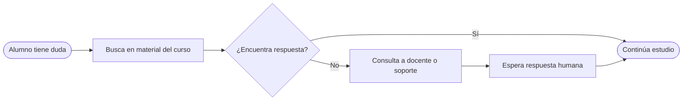
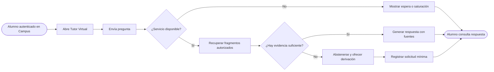
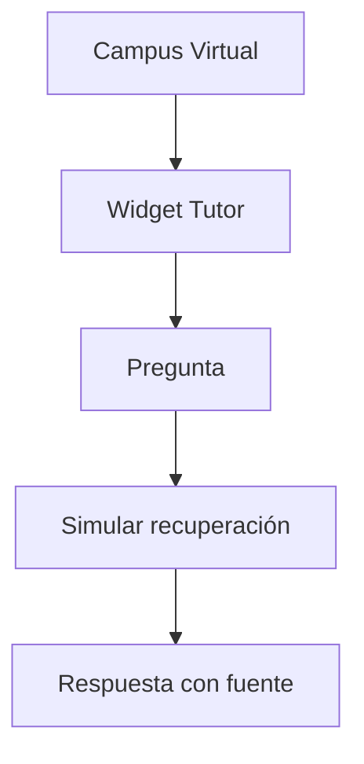
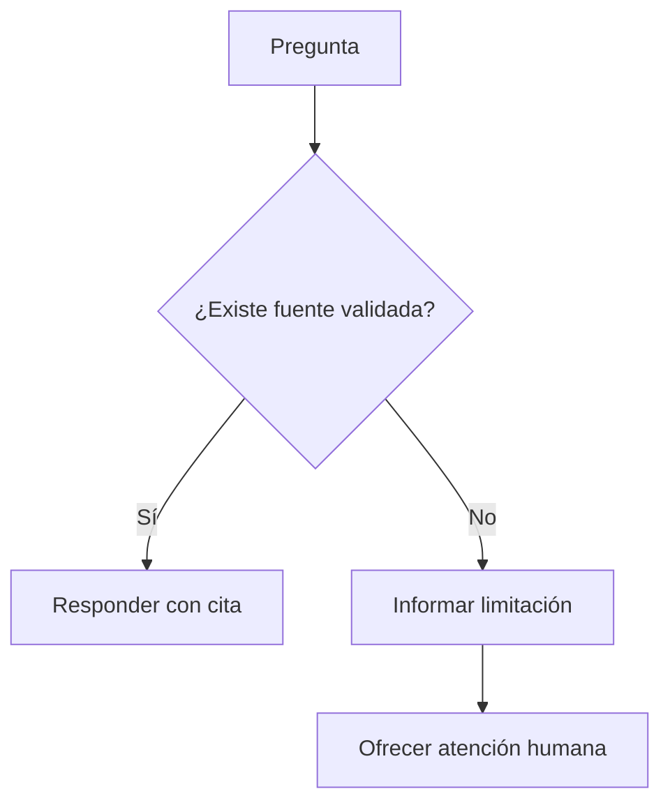
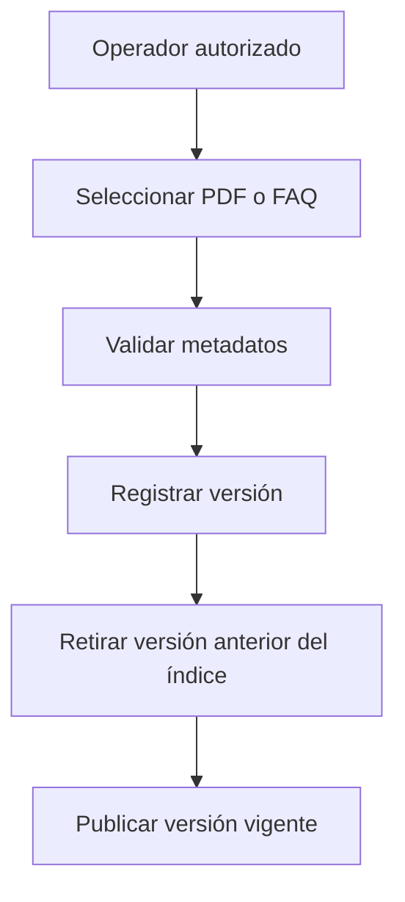
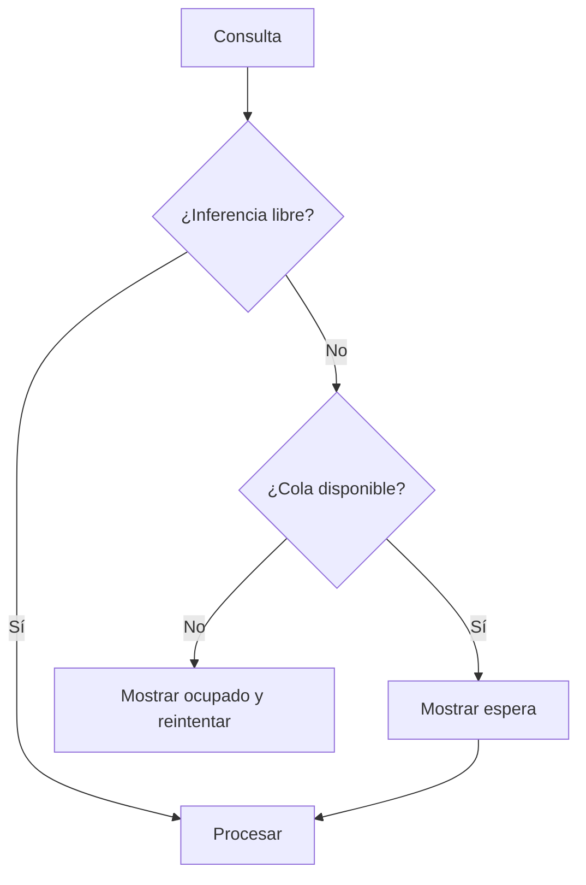
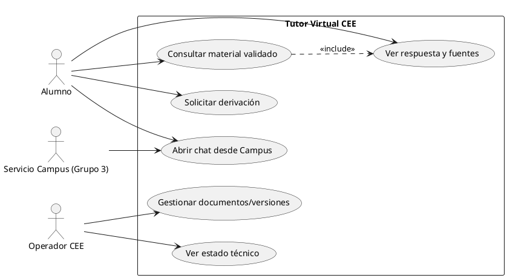
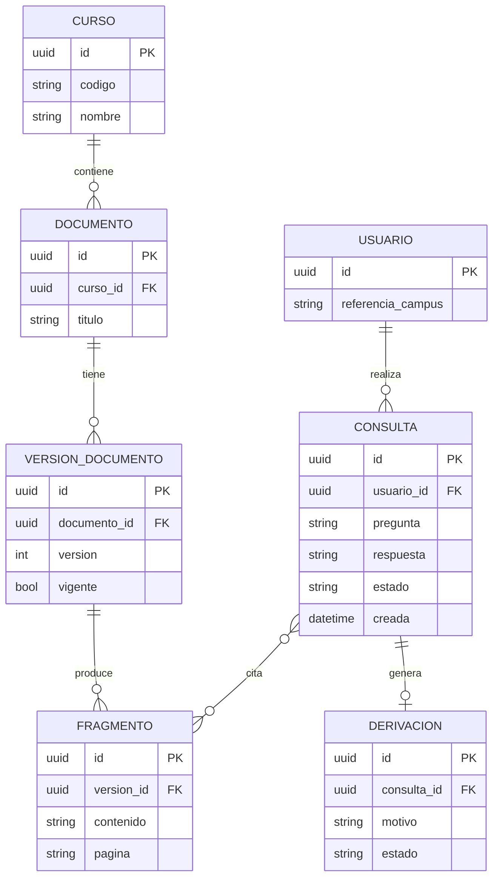

# Diagramas PC2 — propuesta para revisión

## BPMN AS-IS (representación preliminar, NO validada con CEE)

## BPMN TO-BE (flujo propuesto; convertir a BPMN 2.0 formal antes de entrega)

## Flujo 1 — consulta del alumno

## Flujo 2 — evidencia insuficiente

## Flujo 3 — documentos y versiones

## Flujo 4 — saturación

## Casos de uso UML (PlantUML)

## Modelo ER conceptual — 7 entidades propuestas, sujetas a validación

**Nota de modelado:** modelo conceptual de exactamente 7 entidades. La respuesta se almacena como atributo de CONSULTA; las referencias a fragmentos requieren una tabla de unión en un modelo físico posterior. No afirmar que el modelo está aprobado.
